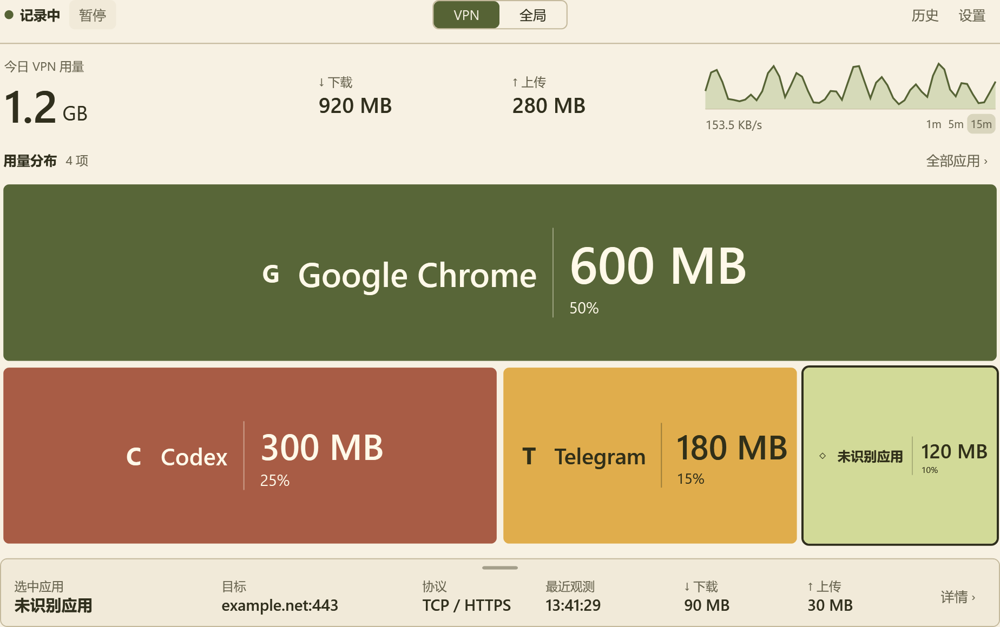

# VPN 流量账本 / VPN Ledger

在 Windows 上查看每个软件的 VPN 用量，或切换到整机网卡统计。点击矩形图中的应用可看上下行与连接线索。历史账本保存在本机。

VPN Ledger shows which Windows apps use your Clash Verge / Mihomo proxy. Switch to system-wide mode to see physical adapter traffic and app usage reported by Windows. Connection clues and daily history stay on your computer.

[项目主页 / Website](https://vpn-ledger.xiaosang.cc/) · [GitHub](https://github.com/holynova/vpn-ledger) · [下载 v1.1.0 Windows x64](https://github.com/holynova/vpn-ledger/releases/download/v1.1.0/VpnLedger.exe) · [经典列表版 v1.0.0](https://github.com/holynova/vpn-ledger/releases/tag/v1.0.0)



[深色主题](docs/dashboard-dark.png) · [历史页](docs/history.png) · [使用指南与统计口径](docs/usage.md)


## 本地运行 / Run locally

适用 Windows 10（2004 及以上）或 Windows 11 x64。下载并双击 `VpnLedger.exe`。To build from source, use the .NET 8 SDK on Windows.

```powershell
dotnet run --project src -c Release
dotnet run --project checks -c Release
```

## 下载页 / Download site

```powershell
npm.cmd ci
npm.cmd run preview
npm.cmd run deploy
```

从主分支在本地手动部署到 Cloudflare Workers。Interface inspired by [Hotspot Ledger](https://github.com/holynova/hotspot-ledger).
